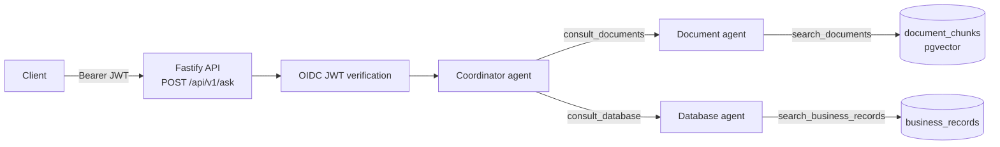

# Knowledge Agent

A multi-tenant, multi-agent question-answering API built with TypeScript, Fastify and the [OpenAI Agents SDK](https://github.com/openai/openai-agents-js). A user asks a question; a coordinator agent consults specialist agents that search indexed documents (pgvector) and structured business records (PostgreSQL), then returns a sourced answer.

> The agent prompts are written in Finnish, so answers are produced in Finnish by default.

## Architecture



- **Coordinator** ([src/agents/coordinator.ts](src/agents/coordinator.ts)): the only user-facing agent. Calls the specialists as tools (`Agent.asTool()`), separates facts from inferences and cites sources.
- **Document agent** ([src/agents/document-agent.ts](src/agents/document-agent.ts)): semantic search over document chunks using embeddings and cosine similarity.
- **Database agent** ([src/agents/database-agent.ts](src/agents/database-agent.ts)): searches `business_records` through a single parameterized, read-only query (max 20 rows). No free-form SQL.
- **Indexer** ([src/services/document-indexer.ts](src/services/document-indexer.ts)): splits documents into overlapping chunks (3000 chars, 300 overlap), embeds them and stores them per tenant.

### Security model

- JWTs are verified against the IdP's JWKS (signature, issuer, audience, expiry, `RS256` only). `OIDC_ISSUER` must be HTTPS.
- The caller needs the role configured in `OIDC_REQUIRED_ROLE` (read from `realm_access.roles`) and a tenant claim.
- `tenantId` comes only from the verified token. Agents are created per request and bound to that tenant, and every query filters by `tenant_id`.
- Agents are instructed to treat retrieved content as untrusted data.
- Request body limit is 16 KB and questions are limited to 4000 characters (validated with Zod).

The auth code assumes Keycloak-style claims. Adjust [src/auth/authenticate.ts](src/auth/authenticate.ts) for other providers.

## Requirements

- Node.js 22+
- PostgreSQL with the [pgvector](https://github.com/pgvector/pgvector) extension
- An OpenAI API key
- An OIDC provider (e.g. Keycloak) issuing RS256 JWTs

## Getting started

```bash
npm install
cp .env.example .env   # then fill in the values
```

Create the schema (enables `vector` and creates `document_chunks`):

```bash
psql "$DATABASE_URL" -f src/db/schema.sql
```

The database agent also expects a `business_records` table (the example schema is in the comment in [src/agents/database-agent.ts](src/agents/database-agent.ts)).

Run in development:

```bash
npm run dev
```

### Configuration

| Variable | Required | Description |
| --- | --- | --- |
| `PORT` | no | HTTP port (default `8080`) |
| `OPENAI_API_KEY` | yes | OpenAI API key |
| `OPENAI_MODEL` | yes | Model used by all agents |
| `OPENAI_EMBEDDING_MODEL` | no | Embedding model (default `text-embedding-3-small`, 1536 dimensions) |
| `DATABASE_URL` | yes | PostgreSQL connection string |
| `OIDC_ISSUER` | yes | Issuer URL (HTTPS). JWKS is read from `<issuer>/protocol/openid-connect/certs` |
| `OIDC_AUDIENCE` | yes | Expected `aud` claim |
| `OIDC_REQUIRED_ROLE` | yes | Role required to call the API |
| `OIDC_TENANT_CLAIM` | no | Claim holding the tenant id (default `tenant_id`) |

## API

### `POST /api/v1/ask`

Requires `Authorization: Bearer <JWT>`.

```bash
curl -X POST http://localhost:8080/api/v1/ask \
  -H "Authorization: Bearer $TOKEN" \
  -H "Content-Type: application/json" \
  -d '{"question": "What is our travel expense policy?"}'
```

Response:

```json
{ "answer": "..." }
```

| Status | Error | Meaning |
| --- | --- | --- |
| 400 | `INVALID_REQUEST` | Body is not `{ "question": string }` (1-4000 chars) |
| 401 | `UNAUTHENTICATED` / `INVALID_TOKEN` | Missing or invalid token |
| 403 | `REQUIRED_CLAIMS_MISSING` / `INSUFFICIENT_ROLE` | Missing subject/tenant claim or required role |
| 502 | `AGENT_REQUEST_FAILED` | The agent run failed |

### Health checks

- `GET /health/live`: liveness
- `GET /health/ready`: readiness, returns 503 if the database is unreachable

## Indexing documents

Use `indexDocument()` from [src/services/document-indexer.ts](src/services/document-indexer.ts). Re-indexing a document replaces its previous chunks in a single transaction.

```ts
import { indexDocument } from "./services/document-indexer.ts";

await indexDocument({
  tenantId: "acme",
  id: "travel-policy",
  title: "Travel policy",
  uri: "https://intranet.example/travel-policy",
  text: "...",
});
```

## Scripts

| Script | Description |
| --- | --- |
| `npm run dev` | Start with `tsx watch` |
| `npm run build` | Compile TypeScript to `dist/` |
| `npm start` | Run the compiled server |
| `npm test` | Run tests once (Vitest) |
| `npm run test:watch` | Run tests in watch mode |

## Deployment

- [tests/Dockerfile](tests/Dockerfile): multi-stage Node 22 image, runs `dist/server.js` on port 8080 and supports OpenShift's arbitrary UIDs.
- [deploy/](deploy): Kustomize manifests. `base/` contains the ConfigMap, Deployment, Service, Route and ServiceAccount; `overlays/test/` adds a sealed secret for the test environment.

```bash
kubectl apply -k deploy/overlays/test
```

## Project structure

```
src/
  app.ts                  Fastify app, health checks
  server.ts               Entry point, graceful shutdown
  agents/                 Coordinator, document and database agents
  auth/authenticate.ts    OIDC/JWT verification
  db/                     Connection pool and schema.sql
  routes/ask.ts           POST /api/v1/ask
  services/               Embeddings, indexing and vector search
tests/                    Vitest tests for indexing and search
deploy/                   Kustomize manifests
```

## Production notes

Before going to production, add and test rate limiting, timeouts and cancellation for model calls, and use a database role with SELECT-only access for the agent queries.
